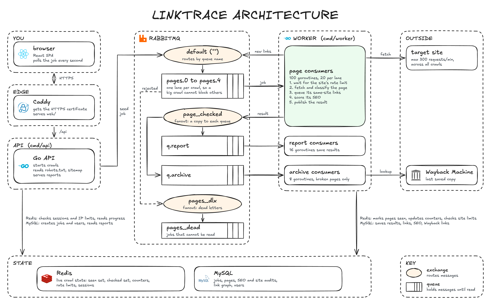

<div align="center">
  
  <h1>Linktrace</h1>
</div>

A distributed site auditor. Page audit extensions only check the page you have open. Linktrace checks the whole site in one go, so you can find every broken link and SEO problem, and why it happened, before your visitors do.

## Architecture



Run `npm --prefix web run docs:architecture` to sync [docs/architecture.excalidraw](docs/architecture.excalidraw) with README

## Tech stack

- **Backend:** Go 1.26 with `chi`, `amqp091-go`, `go-redis` and `x/net/html`
- **Frontend:** React 19, React Router 7, TypeScript, Tailwind CSS 4, [shadcn/ui](https://ui.shadcn.com) (Radix), `lucide-react` icons, `react-force-graph-2d` for the site graph
- **Data:** RabbitMQ 3, Redis 7, MySQL 8
- **Hosting:** Docker Compose on one server, Caddy for HTTPS, GitHub Actions for deploys
- **Security:** sessions in an HttpOnly cookie (7 days), bcrypt password hashes, and an SSRF guard that checks every address at connect time
- **Tooling:** Vite, ESLint, Prettier

## Running locally

Needs Docker, Go 1.26+ and Node 20+.

```bash
cp .env.example .env
npm --prefix web install

make dev          # MySQL, Redis and RabbitMQ in Docker, then the API (:8080), worker and web (:5173)
make dev LAN=1    # also serves the site to other devices on your network
```

## Configuration

Set these as environment variables or in `.env`.

| Variable                | Default | What it does                                                                        |
| ----------------------- | ------- | ----------------------------------------------------------------------------------- |
| `WORKER_COUNT`          | 100     | fetch goroutines per worker                                                         |
| `MAX_PAGES`             | 10000   | pages per crawl                                                                     |
| `ANON_MAX_PAGES`        | 500     | pages per crawl without an account                                                  |
| `MAX_DEPTH`             | 20      | clicks away from the homepage                                                       |
| `MAX_PER_CATEGORY`      | 1000    | pages per first path segment (e.g. `/blog`)                                         |
| `RATE_PER_MIN`          | 300     | requests per minute to one site, across all crawls                                  |
| `SHARD_COUNT`           | 5       | queue lanes (each crawl uses one). Must match on the API and worker                 |
| `ALLOW_PRIVATE_TARGETS` | false   | allows crawling localhost and LAN sites. Dev only, since it disables the SSRF guard |

Connection settings: `MYSQL_DSN`, `REDIS_ADDR`, `RABBIT_URL`, `HTTP_ADDR`, `COOKIE_SECURE` (Defaults point at the dev containers).

## Deploying

Point the domain's A record at the server first, so Caddy can get a certificate.

```bash
ssh root@YOUR_SERVER_IP
git clone https://github.com/Tom-the-Bomb/linktrace.git && cd linktrace
cp .env.production.example .env.production   # DOMAIN, ACME_EMAIL, passwords
docker compose -f docker-compose.prod.yml --env-file .env.production up -d --build
```

Run the last command again to redeploy (append `api`, `worker` or `caddy` to rebuild one service). Pushes to `main` also redeploy over SSH through [deploy.yml](.github/workflows/deploy.yml), using the `DROPLET_*` secrets.

## API

All under `/api`, all JSON.

```
POST   /check                  start a crawl
GET    /check/{id}             status + live progress ({id} is a job UUID)
GET    /check/{id}/results     per-page rows
GET    /check/{id}/report      aggregated report
GET    /check/{id}/graph       nodes + edges
GET    /check/{id}/seo?url=    one page's SEO audit
POST   /check/{id}/cancel
DELETE /check/{id}             job + all its data

POST   /auth/register
POST   /auth/login
POST   /auth/logout
GET    /auth/me                401 if anonymous
DELETE /auth/account           account + all jobs

GET    /history                past crawls (auth)
```

## Limits

Without an account, each site gets one crawl at a time. Starting another just opens the one already running.

Each IP can start 10 crawls, sign-ups or logins a minute. Report pages (results, graph, SEO) allow 240 requests a minute, and everything else allows 1200. One account gets 50 login attempts a minute.

The crawler's user agent is `LinkTraceBot`. It obeys robots.txt, including `Crawl-delay`.

## License

[MIT](LICENSE)
