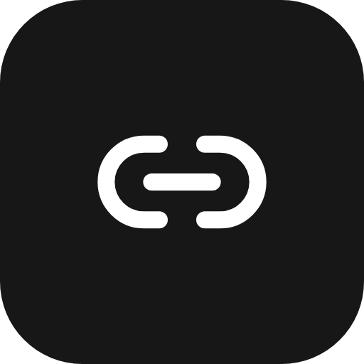

<div align="center">
  
  <h1>Linktrace</h1>
  <p>A distributed site auditor</p>
</div>

Give it a domain and it crawls every page it can reach from the homepage. It reports:

- broken links and why they broke: DNS, timeout, SSL, soft 404, 4xx/5xx, redirect loop and so on
- an SEO score and list of issues for every HTML page
- all of it in an interactive table and graph

## How it works

- `cmd/api`: the HTTP server. Starts crawls and serves reports.
- `cmd/worker`: the crawler. Fetches each page, audits it and queues its links. Run more workers to scale out.

- RabbitMQ delivers pages to the workers and carries results back.
- Redis holds live crawl state (progress counters, the seen set, per-domain rate limits) and sessions.
- MySQL stores jobs, pages, results, the site graph and users.
- Caddy serves `web/`, proxies `/api`, and does HTTPS.

Frontend: React 19 + Tailwind 4, with UI primitives from [shadcn/ui](https://ui.shadcn.com).

## API

All under `/api`, all JSON.

```
POST   /check                  start a crawl
GET    /check/{id}             status + live progress ({id} is a job UUID)
GET    /check/{id}/results     per-page rows
GET    /check/{id}/report      aggregated report
GET    /check/{id}/graph       nodes + edges
GET    /check/{id}/seo?url=    one page's SEO audit
POST   /check/{id}/cancel
DELETE /check/{id}             job + all its data

POST   /auth/register
POST   /auth/login
POST   /auth/logout
GET    /auth/me                401 if anonymous
DELETE /auth/account           account + all jobs

GET    /history                past crawls (auth)
```

## Localhost

Needs Docker (MySQL, Redis and RabbitMQ run in containers), Go 1.26+ and Node 20+.

```bash
cp .env.example .env
npm --prefix web install

make dev           # containers, then API :8080, worker and web :5173 in one terminal
make dev LAN=1     # expose port
```

## Deploying

Point the domain's A record at the server first, so Caddy can get a certificate.

```bash
ssh root@YOUR_SERVER_IP
git clone https://github.com/Tom-the-Bomb/linktrace.git && cd linktrace
cp .env.production.example .env.production   # DOMAIN, ACME_EMAIL, passwords
docker compose -f docker-compose.prod.yml --env-file .env.production up -d --build
```

Run it again to redeploy, with `api`, `worker` or `caddy` on the end to rebuild just that one. Pushes to `main` also
redeploy over SSH ([deploy.yml](.github/workflows/deploy.yml), needs the `DROPLET_*` secrets).

## Config

| Variable                | Default | What it does                                                                                                  |
| ----------------------- | ------- | ------------------------------------------------------------------------------------------------------------- |
| `WORKER_COUNT`          | 100     | fetch goroutines per worker                                                                                   |
| `MAX_PAGES`             | 10000   | pages per crawl                                                                                               |
| `ANON_MAX_PAGES`        | 500     | pages per crawl without an account                                                                            |
| `MAX_DEPTH`             | 20      | clicks away from the homepage                                                                                 |
| `MAX_PER_CATEGORY`      | 1000    | pages per first path segment, like `/blog`                                                                    |
| `RATE_PER_MIN`          | 300     | requests per site per minute, shared by all crawls                                                            |
| `SHARD_COUNT`           | 5       | queue lanes. Each crawl gets one, so a huge crawl can't block the rest. Set it the same on the api and worker |
| `ALLOW_PRIVATE_TARGETS` | false   | lets you crawl localhost and LAN sites. Dev only, or crawls can reach your own Redis and API                  |

Connections: `MYSQL_DSN`, `REDIS_ADDR`, `RABBIT_URL`, `HTTP_ADDR`, `COOKIE_SECURE`. The defaults point at the dev containers.

## Abuse limits

- Without an account, a crawl stops at `ANON_MAX_PAGES`, and a second crawl of the same site joins the first.
- The crawler calls itself `LinkTraceBot` and follows robots.txt, including `Crawl-delay`.
- API requests are rate limited per IP, and logins per account.
